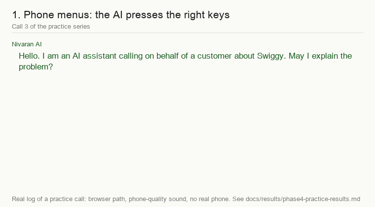
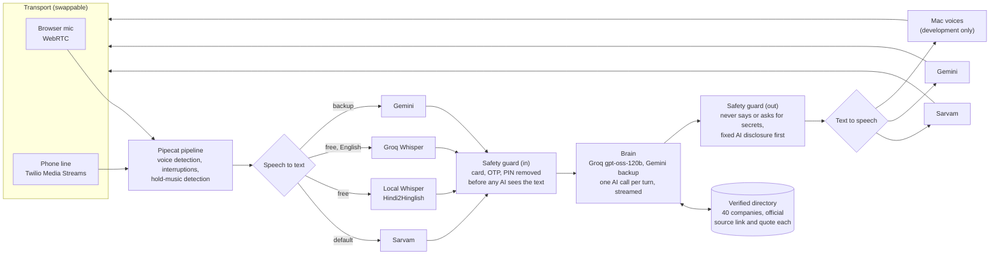

# Nivaran

[](https://github.com/shuklabhoomi521-web/nivaran-ai/actions/workflows/tests.yml)
[](LICENSE)


**An AI customer-care agent for India: you state a problem once, in your own language, and it finds the company's official contact and handles the call for you.** (*Nivaran* means "solution" in Hindi.)

**The problem.** Getting a refund or a fix from an Indian company means hunting for the right helpline, waiting on hold, repeating yourself in a language the agent may not speak, and starting over when nobody follows up. Many big apps (Swiggy, Zomato, Zepto) officially have no customer phone line at all, so the right move is a verified grievance email, not a call. People give up or get scammed by fake "customer care" numbers found on web search.

**The idea.** One agent that understands the problem in English, Hindi, Tamil or Hinglish, looks the company up in a **verified directory** (never in web search), picks the real channel, speaks for you on a call, and never touches your OTP, PIN or card.



*The GIF is a replay of real logs from our recorded practice calls (a computer voice plays the company agent, in the browser, with phone-quality sound). It is not a call to a real company.*

> **Honest status in one line:** the brain, the verified directory, the voice assistant (4 languages) and the phone-call logic work and are tested. **No real company has been called yet**, and the one real Twilio phone call we tried did not complete (see [Status](#status)).

---

## Status

| Phase | What | Status | Proof |
|---|---|---|---|
| 0 | Project setup, CI, docs | **Done** | tag `phase-0-done` |
| 1 | Brain, text only: turns a message into a structured case, asks when a detail is missing, never invents facts | **Partial** (28/30 on a full re-run) | [notes](docs/notes/phase-1.md), [results](docs/results/baseline-phase1.md) |
| 2 | Verified company directory + contact picker | **Done** | [notes](docs/notes/phase-2.md), [checks](docs/results/directory-verification.md) |
| 3 | Voice in the browser, 4 languages, interruptions, speech-model bake-off | **Done** (reply speed goal missed: 2-4 s vs 1.5 s) | [notes](docs/notes/phase-3.md) |
| 4 | Phone calls: the AI as the caller (AI disclosure, keypad menus, hold, transcripts) | **Partial**: tested with simulated phone-quality audio; the real Twilio call is **missing** | [notes](docs/notes/phase-4.md), [practice results](docs/results/phase4-practice-results.md) |
| 5 | Real company calls | Planned (needs KYC with a phone provider and TRAI-rule research) | [roadmap](docs/TODO-research.md) |
| 6-8 | Mobile app, OTP safety, email and escalation | Planned | [plan](docs/PLAN.md) |
| 9 | Our own fine-tuned models replace the outside brain | Planned | [plan](docs/PLAN.md) |
| 10 | Real users and launch | Planned | [plan](docs/PLAN.md) |

---

## Architecture



Everything outside the core sits behind small interfaces (`app/speech/`, `app/brain/llm.py`, `app/channels/phone/base.py`), so a speech provider, the brain or the phone provider can be swapped without touching the rest.

## Results (real numbers, with their limits)

| What was measured | Result | Where | Limit |
|---|---|---|---|
| **Understanding**: 30 test problems (English, Hindi, Tamil, Hinglish; company, category, goal, facts copied exactly) | **28/30 (93%)** strict full re-run; 30/30 under the later meaning-based rule on the same answers | [history](docs/results/baseline-history.md) | Set is small and mostly written by us. The meaning-based rule was relaxed *after* seeing the two misses (approved, but note it). Same prompt can flip a problem between runs. |
| **Directory** | **40 companies**, 10 categories; every contact has an official source link, a quote and a checked-on date. 25/25 problems that name a company get a verified contact. | [checks](docs/results/phase2-contact-check.md) | Only 10 of 63 phone numbers are confirmed on two official pages; the rest are one official source. Real helplines change, so this goes stale. |
| **Speech-to-text, 4 new clips never used for tuning** (12 variants: clean, 8 dB street noise, phone line) | Word error: **Sarvam 0.05**, Gemini 0.42, local Whisper-Hindi2Hinglish 0.45, Groq Whisper 0.51 | [holdout](docs/results/holdout-result.md) | 4 clips, one speaker, artificial noise. Roman-vs-Devanagari spelling inflates the Hindi scores of Gemini and the local model. |
| **Phone calls**, 10 practice calls (rules written before running) | **9 of 10 handled well**; keypad menus passed every time; refused OTP and card requests every time | [results](docs/results/phase4-practice-results.md) | A computer voice plays the agent, in the browser. Zero real phone calls. The failing call (Hindi) was a speed miss with the slow free local model. |
| **Reply speed** | 2-4 s after the other person stops talking (brain 0.5-1.5 s) | [Phase 3 notes](docs/notes/phase-3.md) | Goal was 1.5 s: **not met**. Free tiers can be slow. |
| **Safety tests** | 16 redaction tests, 31 secret/OTP/card/PIN tests, AI disclosure tests in 4 languages; 422 free tests run on every push (CI) | [tests](backend/tests) | Tests prove the rules in code, not that every real-world phrasing is caught. |

## Safety and ethics

- **The AI says it is an AI.** Every call starts with fixed text ("I am an AI assistant calling on behalf of a customer..."), in all four languages. The AI does not write that sentence.
- **Never shares or accepts secrets.** Card numbers, CVV, PIN, passwords and OTPs are removed before any AI sees the text, refused by code when an agent asks, and removed again from anything the AI writes. Numbers spoken as long digit strings are caught too.
- **Only official contacts.** Contacts come from the verified directory with a source link and quote; they are never taken from web search. Unknown company: it says so and asks.
- **No invented facts.** The call brain only uses facts the user gave; missing ones become "I will check with the customer".
- **The user stays in control.** One allowed phone number, a user OK before each call, a Hang up button, a mute button and a type-to-say box. Transcripts are text only, stored encrypted, with secrets removed.
- **Free-tier data.** Google may use free-tier prompts to improve its products, so only test data goes through the free tiers. Real users' data would need a paid tier or our own models (Phase 9, 10).

## Engineering decisions and trade-offs

- **A verified directory, not web search.** Search results (and AI summaries of them) were wrong or stale during Phase 2 (a BSNL page that no longer exists, look-alike "care" sites). Each contact is stored with an exact quote from an official page. Slower to build, safe to act on.
- **Free tiers first.** Built for a student budget: Groq (brain and English hearing), Gemini (backup), a local Whisper model for Hindi/Hinglish, Mac voices for development. Cost: slower and flakier, so everything has a timeout and an automatic backup, and the code is built to swap in paid or self-trained models.
- **Why Sarvam for Indian languages.** It won our bake-off on Hindi, Tamil and Hinglish phone-quality audio (see results); it has a free credit, which we track ourselves and pause below Rs 15.
- **One AI call per turn, streamed.** The first sentence is spoken while the rest is still being written. With Groq at about 1 s per answer the gain is small, and we say so.
- **Safety in code, not only in prompts.** The OTP refusal, the AI disclosure and the secret removal do not depend on the AI behaving.
- **Honest measurement.** Rules for the practice calls were written before running them; every run (including failures) is kept in `docs/results/`.

## Limitations and roadmap

- No real company has been called. The real Twilio test call was not completed: Twilio's trial ended two answered calls after 3-6 seconds without opening the audio stream, and our networks repeatedly dropped the tunnel it needs. Cause not found.
- Speed is 2-4 s per answer; Hindi/Hinglish hearing needs the slow local model or the paid Sarvam.
- Tamil was only tested with computer voices; the fixed Hindi and Tamil sentences were not checked by native speakers.
- Small test sets, one voice, quiet-room practice calls.
- **Next:** Phase 5 (real company calls: phone-provider KYC, TRAI rules), Phases 6-8 (mobile app, safe OTP handling, email and escalation), Phase 9 (our own fine-tuned models replace the outside brain), more languages (Telugu, Kannada, Malayalam, Bengali, Marathi, Gujarati, Punjabi).

## Run it locally (about 5 minutes, all free)

Needs Python 3.12. The free tests need **no keys**.

```bash
git clone https://github.com/shuklabhoomi521-web/nivaran-ai.git && cd nivaran-ai
python3.12 -m venv .venv && source .venv/bin/activate
pip install -r backend/requirements.txt

cd backend && python -m pytest -q          # 400+ free tests, no keys
```

To talk to the voice assistant (free keys: [Groq](https://console.groq.com/keys) and [Gemini](https://aistudio.google.com/apikey)):

```bash
cp .env.example .env                        # then put GROQ_API_KEY and GEMINI_API_KEY in .env (macOS: TTS_PROVIDER=mac gives a free voice)
cd backend && python -m app.voice.server    # first start takes ~30 s
```

Open <http://localhost:7861/voice> in **Chrome** and allow the microphone. To practise the phone-call side (you play the company agent): <http://localhost:7861/phone/browser>. The text chat: `cd backend && uvicorn app.main:app` then <http://127.0.0.1:8000/chat>.

Hindi/Hinglish hearing without paying: `pip install -r requirements-local-models.txt` and set `STT_PROVIDER=local` (about 3 GB RAM, slower). Best quality: a free [Sarvam](https://dashboard.sarvam.ai) key and `STT_PROVIDER=sarvam`.

## Project map

```
backend/app/brain/       understand, call brain, streaming, rate limits       backend/app/voice/    voice + phone bots, hold detection, transcripts
backend/app/directory/   verified companies + contact picker                  backend/app/speech/   speech providers behind one interface, scoring
backend/app/safety/      redaction of secrets                                 backend/app/channels/ phone provider interface (Twilio)
scripts/                 evaluation and demo scripts                          experiments/          one-off research scripts
docs/PLAN.md             the full plan                                        docs/results/         every measured result, kept
docs/notes/              what each phase built, broke and learned             docs/WRITEUP.md       2-page technical write-up
```

License: [MIT](LICENSE).
